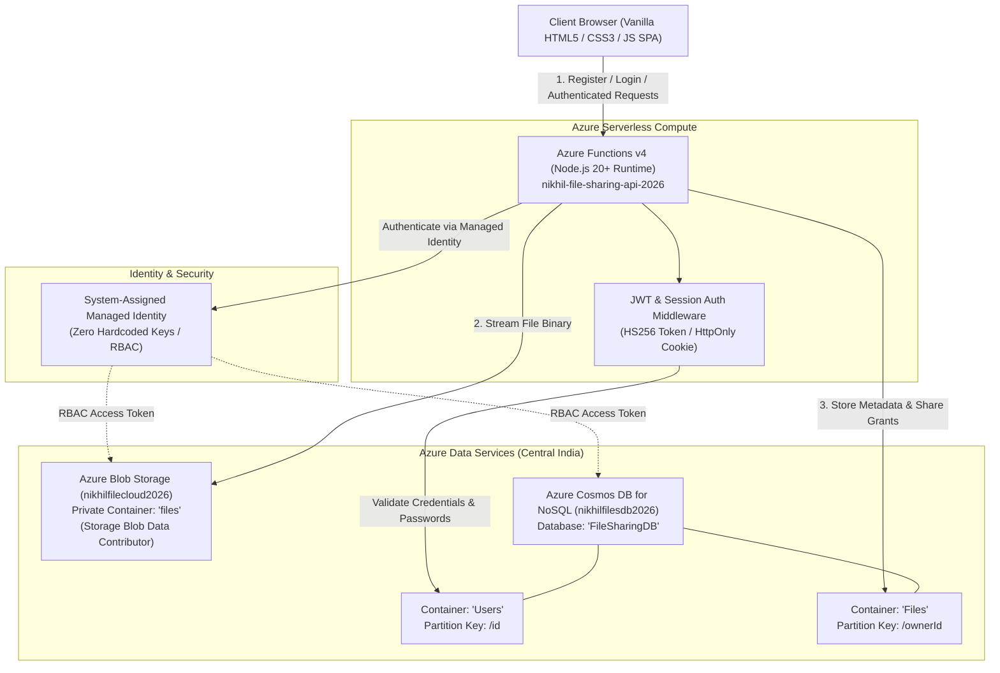

# Cloud-Based File Sharing System

A secure, cloud-native file sharing platform engineered on **Azure Serverless Architecture** with a dedicated **Application-Level Authentication System** (Gmail format validation + bcrypt password hashing + JWT sessions). The platform provides a modern SaaS Single Page Application (SPA) experience featuring encrypted object storage in Azure Blob Storage, metadata and document management in Azure Cosmos DB, granular role-based file access control, and zero-credential cloud authorization via Azure Managed Identity.

---

## Table of Contents
- [Project Overview](#project-overview)
- [Problem Statement and Objectives](#problem-statement-and-objectives)
- [System Architecture](#system-architecture)
- [Key Features & Modules](#key-features--modules)
- [Technologies Used](#technologies-used)
- [Azure Services & Responsibilities](#azure-services--responsibilities)
- [Azure Portal Resource Management](#azure-portal-resource-management)
- [Data Models](#data-models)
- [API Endpoints Reference](#api-endpoints-reference)
- [Environment Variables Configuration](#environment-variables-configuration)
- [Local Setup & Installation](#local-setup--installation)
- [Testing & Quality Assurance](#testing--quality-assurance)
- [Security & Best Practices](#security--best-practices)
- [Future Enhancements](#future-enhancements)

---

## Project Overview

The **Cloud-Based File Sharing System** is designed to address the need for reliable, high-performance, and secure personal and collaborative cloud file management. Built using modern cloud engineering principles, it separates compute, storage, and database tiers into fully managed, auto-scaling Azure serverless resources. 

Users can register with their Gmail address, securely log in, upload files up to 10 MB, organize files by category, inspect file metadata, stream downloads directly from private blob storage, and share files with other registered users under granular viewer or editor permissions.

---

## Problem Statement and Objectives

### Problem Statement
Traditional file-sharing architectures often rely on monolithic backend services with local file storage, static access keys, and complex identity dependencies that introduce single points of failure, security vulnerabilities (such as exposed credentials and unauthorized access), and high infrastructure maintenance overhead.

### Objectives
1. **Serverless & Scalable**: Decouple the API logic from compute maintenance using Azure Functions v4 on a Consumption tier.
2. **Enterprise-Grade Cloud Security**: Eliminate hardcoded connection secrets and master keys in production using Azure Managed Identity (`DefaultAzureCredential`) with Role-Based Access Control (RBAC).
3. **Application-Level Privacy**: Implement isolated user accounts with salted bcrypt password hashing (10 rounds) and signed JSON Web Tokens (JWT) supporting HttpOnly cookies and Bearer token headers.
4. **Resilient Data Consistency**: Store unstructured binaries in private Azure Blob Containers while storing structured metadata, ownership, and sharing relationships in Azure Cosmos DB with automatic transaction cleanup on upload failures.
5. **Modern, Responsive User Experience**: Deliver a responsive Single Page Application (HTML5, modern CSS3 design system, vanilla JavaScript) that works seamlessly across desktop and mobile devices without heavy third-party framework overhead.

---

## System Architecture



### Architectural Highlights
- **Stateless Compute**: Azure Functions scale dynamically based on request load.
- **Private Blob Storage**: Public anonymous blob access is disabled. Binaries can only be retrieved through the authenticated API gateway.
- **Partitioned Cosmos DB**:
  - `Users` container partitioned by `/id` for point reads and identity operations.
  - `Files` container partitioned by `/ownerId` for high-performance scoped queries on user file listings and share records.
- **Rollback Resilience**: In `uploadFile`, if the Cosmos DB metadata write fails after the blob has been uploaded, an automatic catch handler purges the orphaned blob from Azure Blob Storage to prevent storage leaks.

---

## Key Features & Modules

### 1. Authentication & Session Module
- **Gmail Format Validation**: Enforces `@gmail.com` addresses with regex format checking.
- **Password Policies**: Enforces minimum 8 characters with confirmation match.
- **Cryptographic Hashing**: Passwords hashed using `bcrypt` (10 salt rounds). Plaintext passwords and hashes are never exposed in API responses or logs.
- **Session Tokens**: Signed JWTs (`HS256`) with a 7-day expiration. Sent via `Authorization: Bearer <token>` or stored as an `HttpOnly`, `SameSite=Lax` session cookie.
- **Generic Auth Errors**: Prevents user enumeration by returning standard `"Invalid email or password"` on authentication failures.

### 2. File Management & Upload Module
- **Multipart Upload**: Upload files up to 10 MB via standard `multipart/form-data`.
- **Sanitized Filenames & Collisions**: Generates a UUID prefix for every file (`${fileId}-${safeFileName}`) and sanitizes filename characters.
- **MIME Type Tracking**: Stores Content-Type for correct stream handling during downloads.
- **Storage Metrics**: Dynamic tracking of total storage quota (10 GB) and used storage on the dashboard.

### 3. File Listing, Search & Categorization
- **Owner-Scoped Queries**: Lists all files owned by the authenticated user partitioned by `ownerId`.
- **Category Filtering**: Filter files on the fly by category: All, Documents (`pdf`, `doc`, `docx`, `txt`), Images (`png`, `jpg`, `jpeg`, `gif`, `webp`), Audio (`mp3`, `wav`), Video (`mp4`, `mkv`), and Archives (`zip`, `rar`, `tar`).
- **Real-Time Search**: Search through file names in real time.
- **Multi-Field Sorting**: Sort by name (A-Z, Z-A), upload date (newest/oldest), or file size (smallest/largest).
- **View Modes**: Switch between responsive Grid view and detailed List view.

### 4. File Sharing & Collaboration Module
- **Granular Sharing Grants**: Owners can share files with other registered Gmail users by specifying the recipient email and permission level (`viewer` or `editor`).
- **Self-Sharing Prevention**: Automatically rejects requests when users attempt to share a file with themselves.
- **Duplicate Share Protection**: Prevents duplicate share records for the same user and file.
- **Shared With Me View**: Dedicated view showing files shared with the current user, including sharing timestamp and sharer details.
- **Automatic OID Binding**: Automatically binds the verified application user ID to share records on subsequent interactions.

### 5. Secure Streaming Download Module
- **Access Control Verification**: Downloads verify that the caller is either the file owner or an authorized recipient in the Cosmos DB share registry.
- **Direct Blob Streaming**: Streams binary chunks directly from Azure Blob Storage with appropriate MIME types.
- **RFC 5987 Compliant Filename Headers**: Encodes `Content-Disposition` headers (`filename` and `filename*=UTF-8''...`) ensuring special characters in filenames download properly across all browsers.

### 6. Cascade File Deletion Module
- **Owner Authorization**: File deletion is restricted strictly to the file owner; shared recipients receive `403 Forbidden`.
- **Atomic-Style Cleanup**: Deletes the binary from Azure Blob Storage, removes the file record from Cosmos DB, and cascades deletion across all active share records referencing the file ID.

### 7. Modern UI & Diagnostics
- **Glassmorphic 2026 SaaS Design**: Built with clean CSS tokens, responsive flexbox/grid, and native `<dialog>` modals.
- **Theme Support**: Seamless Dark Mode and Light Mode switching with local preference persistence.
- **Diagnostics**: Built-in `/api/health` and `/api/azureTest` endpoints for real-time monitoring of Azure service connectivity.

---

## Technologies Used

| Layer | Technology | Description |
| :--- | :--- | :--- |
| **Frontend UI** | HTML5, CSS3, JavaScript (ES2022) | Lightweight, dependency-free Single Page Application |
| **Styling** | Vanilla CSS3 (Custom Properties) | Glassmorphism, CSS variables, dark/light theme, responsive grid/flex |
| **Backend Runtime** | Node.js (v20+ / v24+) | Serverless JavaScript runtime environment |
| **Serverless Framework** | Azure Functions v4 (`@azure/functions`) | Modern v4 programming model for HTTP triggers |
| **Cloud Storage SDK** | `@azure/storage-blob` (v12.34.0) | Azure Blob Storage client for binary data transfer |
| **Database SDK** | `@azure/cosmos` (v4.10.1) | Azure Cosmos DB SQL API client for document storage |
| **Identity SDK** | `@azure/identity` (v4.13.3) | DefaultAzureCredential for Managed Identity and RBAC |
| **Password Security** | `bcryptjs` (v3.0.3) | Cryptographic password hashing (10 salt rounds) |
| **Token Authentication** | `jsonwebtoken` (v9.0.3) | Signed JWT creation, parsing, and cryptographic verification |

---

## Azure Services & Responsibilities

| Azure Service | Resource Name | Region | Responsibility |
| :--- | :--- | :--- | :--- |
| **Resource Group** | `cloud-file-sharing-rg` | Central India | Logical grouping and lifecycle boundary for all deployed cloud assets. |
| **Azure Functions App** | `nikhil-file-sharing-api-2026` | Central India | Serverless compute hosting the RESTful API endpoints. |
| **Azure Blob Storage** | `nikhilfilecloud2026` | Central India | Scalable, highly available object storage housing uploaded file binaries. Private access tier with zero anonymous public read permissions. |
| **Azure Cosmos DB** | `nikhilfilesdb2026` | Central India | Globally distributed NoSQL database (`FileSharingDB`) managing two collections: `Users` (account details and password hashes) and `Files` (file metadata and sharing grants). |
| **Managed Identity** | System-Assigned | Central India | Cryptographic identity assigned to the Function App, granting `Storage Blob Data Contributor` and Cosmos DB RBAC roles without needing static storage keys. |
| **Function Storage** | `cloudfilesharingrga2a8` | Central India | Backing storage account required for Azure Functions WebJobs state and internal task management. |

---

## Azure Portal Resource Management

To inspect, monitor, or manage the Azure resources provisioned for this project, use the following direct links to the official Azure Portal:

| Resource Type | Direct Portal Navigation Link | Purpose |
| :--- | :--- | :--- |
| **Azure Portal Home** | [https://portal.azure.com/](https://portal.azure.com/) | Primary administrative dashboard for Microsoft Azure. |
| **Azure Storage Accounts** | [Azure Blob Storage Accounts](https://portal.azure.com/#view/HubsExtension/BrowseResource/resourceType/Microsoft.Storage%2FStorageAccounts) | Browse and inspect the `nikhilfilecloud2026` storage account, containers, and metrics. |
| **Azure Functions** | [Azure Function Apps](https://portal.azure.com/#view/HubsExtension/BrowseResource/resourceType/Microsoft.Web%2Fsites/kind/functionapp) | View `nikhil-file-sharing-api-2026`, monitor function execution logs, and check configuration. |
| **Azure Cosmos DB** | [Azure Cosmos DB Accounts](https://portal.azure.com/#view/HubsExtension/BrowseResource/resourceType/Microsoft.DocumentDb%2FdatabaseAccounts) | Inspect the `nikhilfilesdb2026` NoSQL database, `Users` and `Files` containers via Data Explorer. |

> [!NOTE]
> The links above open standard Microsoft Azure management views. Access requires authenticating with an active Azure account holding appropriate subscription permissions (e.g., Reader, Contributor, or Owner) on the `cloud-file-sharing-rg` resource group.

---

## Data Models

### 1. User Document (`Users` container, Partition Key: `/id`)
```json
{
  "id": "a4999a66-6137-4069-b1a5-7a0e6b4bade8",
  "type": "user",
  "email": "user@gmail.com",
  "passwordHash": "$2b$10$wK...",
  "name": "user",
  "createdAt": "2026-10-29T10:15:00.000Z"
}
```

### 2. File Metadata Document (`Files` container, Partition Key: `/ownerId`)
```json
{
  "id": "3f721d0a-8bf3-42e1-95c2-b5e11d04ec92",
  "type": "file",
  "ownerId": "a4999a66-6137-4069-b1a5-7a0e6b4bade8",
  "ownerEmail": "user@gmail.com",
  "ownerName": "user",
  "fileName": "project-spec.pdf",
  "blobName": "3f721d0a-8bf3-42e1-95c2-b5e11d04ec92-project-spec.pdf",
  "contentType": "application/pdf",
  "size": 524288,
  "createdAt": "2026-10-29T10:16:30.000Z"
}
```

### 3. Share Grant Document (`Files` container, Partition Key: `/ownerId`)
```json
{
  "id": "761d4a8e-5b12-4f33-91ac-7b5f9e872110",
  "type": "share",
  "fileId": "3f721d0a-8bf3-42e1-95c2-b5e11d04ec92",
  "ownerId": "a4999a66-6137-4069-b1a5-7a0e6b4bade8",
  "ownerEmail": "user@gmail.com",
  "sharedBy": "user@gmail.com",
  "sharedByName": "user",
  "sharedWith": "collaborator@gmail.com",
  "sharedWithOid": "9bffb532-5f84-4c57-9262-3dd48b69593a",
  "permission": "viewer",
  "fileName": "project-spec.pdf",
  "contentType": "application/pdf",
  "size": 524288,
  "createdAt": "2026-10-29T10:18:00.000Z"
}
```

---

## API Endpoints Reference

### Authentication Endpoints

| Method | Endpoint | Auth | Description |
| :--- | :--- | :--- | :--- |
| `POST` | `/api/auth/register` | Anonymous | Register a new user with `@gmail.com` email and password (min 8 chars). Returns `201 Created`. |
| `POST` | `/api/auth/login` | Anonymous | Authenticate with email and password. Returns JWT token and sets `HttpOnly` session cookie. |
| `POST` | `/api/auth/logout` | Anonymous | Logs out the current session and clears the session cookie. |
| `GET` | `/api/auth/me` | Bearer / Cookie | Returns current user profile `{ id, email, name }`. Returns `401 Unauthorized` if unauthenticated. |

### File Management Endpoints

| Method | Endpoint | Auth | Description |
| :--- | :--- | :--- | :--- |
| `POST` | `/api/uploadFile` | Protected | Uploads file via `multipart/form-data` (form field `file`, max 10 MB). Stores blob and saves metadata. |
| `GET` | `/api/listFiles` | Protected | Lists all files owned by the authenticated user partitioned by `ownerId`. |
| `GET` | `/api/files/{id}` | Protected | Retrieves file metadata if caller is owner or authorized recipient in share records. |
| `GET` | `/api/files/{id}/download` | Protected | Streams binary data from Azure Blob Storage with appropriate `Content-Disposition`. |
| `POST` | `/api/files/{id}/share` | Protected (Owner) | Shares a file with another user by email (`sharedWith`) and `permission` (`viewer` or `editor`). |
| `GET` | `/api/shared-files` | Protected | Lists all files shared with the current user. |
| `DELETE` | `/api/files/{id}` | Protected (Owner Only) | Deletes blob from Azure Storage, removes metadata, and cascades deletion of all share grants. Returns `403` for non-owners. |

### Diagnostic & Health Endpoints

| Method | Endpoint | Auth | Description |
| :--- | :--- | :--- | :--- |
| `GET` | `/api/health` | Anonymous | Returns service status and current UTC ISO timestamp. |
| `GET` | `/api/azureTest` | Anonymous | Tests Azure connectivity via `DefaultAzureCredential` to Blob Storage and Cosmos DB. |

---

## Environment Variables Configuration

The backend functions rely on configuration variables provided via environment variables in Azure App Service Configuration or locally in `backend/local.settings.json`.

A template configuration is provided in `backend/local.settings.example.json`:

```json
{
  "IsEncrypted": false,
  "Values": {
    "FUNCTIONS_WORKER_RUNTIME": "node",
    "AzureWebJobsStorage": "UseDevelopmentStorage=true",
    "AZURE_STORAGE_ACCOUNT_NAME": "<YOUR_AZURE_STORAGE_ACCOUNT_NAME>",
    "AZURE_STORAGE_CONTAINER_NAME": "files",
    "COSMOS_DB_ENDPOINT": "https://<YOUR_COSMOS_DB_ACCOUNT>.documents.azure.com:443/",
    "COSMOS_DB_DATABASE": "FileSharingDB",
    "COSMOS_DB_CONTAINER": "Files",
    "COSMOS_DB_USERS_CONTAINER": "Users",
    "SESSION_SECRET": "<YOUR_RANDOM_SECURE_JWT_SECRET>"
  },
  "Host": {
    "CORS": "http://localhost:5500,http://localhost:5500/,http://127.0.0.1:5500",
    "CORSCredentials": true
  }
}
```

### Environment Variable Details

| Variable | Description | Example / Default |
| :--- | :--- | :--- |
| `FUNCTIONS_WORKER_RUNTIME` | Azure Functions worker process | `node` |
| `AzureWebJobsStorage` | Connection string for Azure Functions host runtime | `UseDevelopmentStorage=true` or Azure Storage connection string |
| `AZURE_STORAGE_ACCOUNT_NAME` | Name of the Azure Blob Storage account | `nikhilfilecloud2026` |
| `AZURE_STORAGE_CONTAINER_NAME` | Container name for uploaded files | `files` |
| `COSMOS_DB_ENDPOINT` | Cosmos DB NoSQL account endpoint URI | `https://<account>.documents.azure.com:443/` |
| `COSMOS_DB_DATABASE` | Target Cosmos DB database name | `FileSharingDB` |
| `COSMOS_DB_CONTAINER` | Container for file metadata and shares | `Files` |
| `COSMOS_DB_USERS_CONTAINER` | Container for user accounts and password hashes | `Users` |
| `SESSION_SECRET` | Secret key used to cryptographically sign session JWTs | High-entropy string (e.g. 64 random characters) |
| `CORS` | Allowed CORS origins for the frontend app | `http://localhost:5500` |
| `CORSCredentials` | Enable credentials (cookies & auth headers) across origins | `true` |

> [!CAUTION]
> Never commit `local.settings.json` or any file containing real Azure account keys or secrets to version control. The repository `.gitignore` is configured to prevent accidental commits.

---

## Local Setup & Installation

### Prerequisites
- **Node.js**: v20 LTS or higher (`node -v`)
- **npm**: v10 or higher (`npm -v`)
- **Azure Functions Core Tools**: v4 (`func --version`)
- **Azure CLI** (for local Managed Identity login): `az login`
- **Azurite** (optional, for local offline storage emulation)

### 1. Clone the Repository
```bash
git clone https://github.com/nikhilmalakala/cloud-based-file-sharing-system.git
cd cloud-based-file-sharing-system
```

### 2. Configure Backend Settings
1. Navigate to the `backend` folder:
   ```bash
   cd backend
   ```
2. Copy the template settings file:
   ```bash
   cp local.settings.example.json local.settings.json
   ```
3. Populate `local.settings.json` with your Azure resource names and database settings.
4. Install backend dependencies:
   ```bash
   npm install
   ```

### 3. Authenticate with Azure (for Local Execution)
Because the codebase uses `DefaultAzureCredential`, authenticate using the Azure CLI so your local environment acquires the necessary RBAC permissions:
```bash
az login
```

### 4. Start the Backend API
```bash
func start
```
The local API server will initialize at:
`http://localhost:7071`

### 5. Launch the Frontend
In a new terminal window:
```bash
cd ../frontend
# Serve using any static HTTP server, for example:
npx http-server ./ -p 5500 -c-1
```
Open your browser and navigate to:
`http://localhost:5500`

---

## Testing & Quality Assurance

### End-to-End Automated Verification
An end-to-end automated test script is provided in `backend/scratch/test_e2e_auth.js`. It executes full-cycle verification across all application workflows:
- Unauthenticated rejection on protected endpoints (401 verification)
- Email format validation (rejecting non-Gmail domains)
- Password policy and confirmation matching
- User registration and duplicate account rejection (409 Conflict)
- User login, bcrypt password verification, and JWT issuance
- File upload with multipart encoding and Cosmos DB metadata creation
- File retrieval, owner verification, and streaming binary download
- File sharing with registered recipients and self-sharing rejection
- Recipient listing in the "Shared with Me" view
- Owner-only deletion and recipient deletion block (403 Forbidden)
- Cascade deletion of associated share records

To execute the automated verification suite against a running local backend:
```bash
cd backend
node scratch/test_e2e_auth.js
```

### Manual Verification Checklist
1. **Registration**: Register a new user at `http://localhost:5500` with an `@gmail.com` address.
2. **File Upload**: Drag-and-drop or browse to upload an image or PDF under 10 MB.
3. **Download**: Click the download action button to verify proper streaming download with correct filename and extension.
4. **Sharing**: Open the share dialog, enter another registered Gmail address, and assign Viewer permissions.
5. **Shared View**: Log in as the second user and verify that the file appears in the "Shared with Me" section.
6. **Deletion**: Return to the owner account, delete the file, and confirm that both the blob and share records are purged.

---

## Security & Best Practices

1. **Zero Secret Keys in Application Code**: Azure resource authorization uses `@azure/identity`'s `DefaultAzureCredential`. When deployed to Azure, the application uses the App Service's system-assigned managed identity with RBAC roles (`Storage Blob Data Contributor`, `Cosmos DB Built-in Data Contributor`).
2. **Strict Identity Isolation**: Plaintext passwords are never stored in databases, never written to log streams, and never returned in API payloads.
3. **Partition-Isolated Queries**: Queries against Cosmos DB are scoped to specific partitions (`/id` for users and `/ownerId` for files) to ensure efficient index utilization and strict tenant isolation.
4. **Sanitized File Names**: User-supplied filenames are sanitized to strip directory traversal sequences and special characters before persisting blob references.
5. **CORS and Cookie Protection**: API hosts restrict Cross-Origin Resource Sharing (CORS) strictly to authorized frontend origins and mark authentication session cookies as `HttpOnly` and `SameSite=Lax`.

---

## Future Enhancements

The current implementation provides a complete, working serverless file-sharing solution. Planned enhancements include:
- **Hierarchical Folders**: Support for nested directory and folder structures in Cosmos DB metadata.
- **Chunked Resumable Uploads**: Azure Blob block-level chunked uploading for files exceeding 100 MB.
- **Time-Expiring Share Links**: Support for temporary public read access via short-lived Shared Access Signatures (SAS) with expiration timestamps.
- **Password-Protected Share Links**: Link-based sharing allowing recipients without accounts to view files with a one-time passcode.
- **Virus & Malware Scanning**: Automated scan pipeline using Azure Event Grid and Microsoft Defender for Cloud Storage upon blob creation.

---

## License

This project is open-source and available under the [MIT License](LICENSE).
